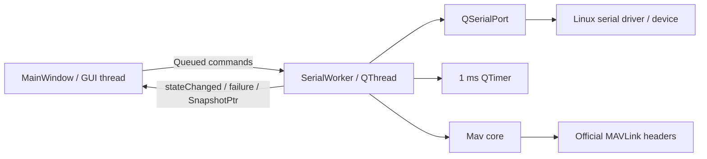

# Architecture

**Phạm vi:** desktop serial workbench cho Ubuntu/Linux, C++17 và Qt 6. Tài liệu mô tả source trong checkout hiện tại; UI trong branch khác có thể dùng tên panel khác.

## Thành phần và dependency

| Thành phần | Source | Trách nhiệm |
| --- | --- | --- |
| Application | [main.cpp](../src/main.cpp) | Tạo `QApplication`, `MainWindow`, chạy event loop |
| GUI | [window.h](../src/window.h), [window.cpp](../src/window.cpp) | UART configuration, TX editor/cards, RX tree/field inspector, themes |
| Serial worker | [worker.h](../src/worker.h), [worker.cpp](../src/worker.cpp) | QSerialPort, TX scheduling, parsing, statistics, snapshot |
| Protocol/core | [core.h](../src/core.h), [core.cpp](../src/core.cpp) | Official metadata adapter, codec, persistent parser, rates, capacity và bounded queue; không phụ thuộc Qt |
| MAVLink | `third_party/mavlink` | Official generated C library, dialect `ardupilotmega` gồm `common` |
| Tests | [core_tests.cpp](../tests/core_tests.cpp), [desktop_tests.cpp](../tests/desktop_tests.cpp) | Core boundaries, PTY integration, widget actions và offscreen screenshots |
| Launcher | [cli.sh](../cli.sh) | Chạy build có sẵn với Qt runtime/plugin paths lấy từ CMake cache |

[CMakeLists.txt](../CMakeLists.txt) tạo `mavcore`, `mavdesktop`, executable `mavlink-lab` và hai test targets. `BUILD_GUI=OFF` chỉ build core; `BUILD_TESTING=OFF` bỏ tests. Full build cần Qt ≥6.2 Widgets/SerialPort và Qt Test khi bật tests. Desktop tests dùng Linux PTY API và link `util`. Repository hiện không có CI workflow được theo dõi trong Git.

MAVLink là git submodule, pin tại `a2d0ecf011a4aaa7840480e43f4e38d8c9e79d29` trong baseline được kiểm tra. Dùng revision của parent checkout làm chuẩn; không chỉnh generated headers để thêm application behavior.

## Threading và ownership



**Khởi tạo:** `MainWindow` đăng ký queued metatypes, tạo worker không có parent, `moveToThread`, nối `QThread::started` với `initialize()`, rồi start thread. `initialize()` tạo port và timer với worker làm parent, vì vậy các resource này thuộc worker thread. GUI có timer riêng 200 ms.

**Trao đổi:** GUI gửi command bằng queued invocation/connection. Worker phát `SnapshotPtr = std::shared_ptr<const Snapshot>`; GUI không đọc trực tiếp mutable worker state. GUI chỉ cho phép một snapshot request đang chờ, tránh tích lũy refresh requests. Không gọi trực tiếp worker slots từ GUI thread sau khi worker đã được chuyển thread.

**Shutdown:** GUI dừng refresh, gọi `closePort()` bằng blocking queued invocation, `quit()` và `wait()` thread. `finished` nối với `deleteLater()` của worker. Không thay trình tự này bằng việc xóa worker khi event loop còn đang xử lý I/O.

## Runtime flow

### Connect và disconnect

1. GUI validate port path và baud từ 1 đến 12000000; driver vẫn có thể từ chối cấu hình.
2. `openPort()` đóng session cũ trước, phát `Connecting`, cấu hình framing/flow rồi mở ReadWrite.
3. Thành công: reset parser/RX streams/byte accumulators, phát `Connected`. TX entries còn trong memory nhưng đã stopped; không tự gửi HEARTBEAT hay message khác.
4. `closePort()` dừng mọi periodic TX, discard pending output, đóng port, reset parser/TX sequence state rồi phát `Disconnected`.

Serial errors dẫn tới đóng port, phát trạng thái `Error` và `failure(reason)`. Không có reconnect tự động hay lưu session xuống disk.

### TX

```text
Editor -> saveEntry (validated, stopped)
Start -> capacity check -> active + immediate deadline
1 ms tick -> due -> official encode -> application queue -> partial writes -> Qt output
Send once --------------------------> encode -> queue -> pump
```

**Payload cố định:** scheduler không tự tăng timestamp, counter hoặc tạo dữ liệu sensor. Sequence state dùng chung cho các entries có cùng sender `(sysid, compid)`. Deadline dùng monotonic microseconds; khi trễ, đặt lần tiếp theo từ thời điểm hiện tại, không phát catch-up burst. Linux/Qt timer là best effort, không hard realtime.

`pump()` xử lý partial writes. Frame count và measured TX Hz tăng khi toàn bộ frame đã được chuyển vào Qt output, không phải khi peer nhận được. TX B/s lấy từ `bytesWritten` trong khoảng giữa hai snapshot requests.

**Cancellation có phạm vi chung:** Stop một entry, Stop all, remove, hoặc replace một entry đều discard application queue và yêu cầu clear Qt output. Các entry khác vẫn active sẽ gửi tiếp ở deadline của chúng. Bytes đã truyền không thu hồi được; frame đang truyền dở có thể bị cắt.

### RX và inspector

`readyRead` đọc tối đa 8192 bytes mỗi lượt. Nếu còn dữ liệu, worker lên lịch lượt đọc tiếp qua `singleShot(0, ...)`. Một `Mav::Parser` giữ state xuyên chunks và dùng official frame parser/CRC. `Receiver` lưu message mới nhất, count, last timestamp và rate theo **sysid + compid + msgid**.

Snapshot chuyển latest messages và statistics sang GUI. RX tree cập nhật tại chỗ theo System → Component → Message; inspector decode bằng official field metadata. Pause Display dừng cập nhật RX presentation, parser/counters vẫn chạy và TX/metrics vẫn cập nhật. Clear reset RX/parser và byte-rate accumulators, không xóa TX entries/counts.

## Constraints và ý nghĩa đo lường

| Giới hạn/metric | Implementation |
| --- | --- |
| TX entries | Tối đa 128 |
| RX identities | Tối đa 2048; identity mới vượt giới hạn làm tăng `overflow`, identity cũ vẫn cập nhật |
| Application TX queue | 16384 bytes; overflow/serialization failure dừng entry đang enqueue |
| Qt pending output | `pump()` giới hạn 4096 bytes |
| Qt read buffer | 65536 bytes |
| Rate | Count trong trailing 1 second; ở rate thấp không tương đương inverse interarrival period |
| RX age | Seconds từ frame mới nhất; GUI đánh dấu Stale khi lớn hơn 2 seconds |
| GUI snapshots | Request mỗi 200 ms, tối đa một request đang chờ |

Các giới hạn trên không phải total-memory budget: rate windows chứa timestamp theo số events trong một giây; snapshots copy dữ liệu. Không có fixed RAM footprint cho toàn process.

**Protocol:** hỗ trợ MAVLink 1/2 theo dialect được compile. MAVLink 1 chỉ cho IDs ≤255 và bỏ extension fields. Payload editing dùng `wire_offset`, không dùng C struct offset. Missing trailing bytes decode thành zero; units/enum descriptions không có trong metadata adapter. HEARTBEAT `mavlink_version=3` do generated packer cung cấp.

**Security:** không cấu hình signing keys, outbound signing hoặc signature authentication. Signed frames được parser chấp nhận không chứng minh authenticity; sequence gaps không được báo là confirmed packet loss. Unknown dialect IDs không được đảm bảo CRC validation/decoding.

**Hardware boundary:** ứng dụng dùng asynchronous QSerialPort. DMA thuộc hardware/kernel driver nếu có; project không có firmware, HAL, ISR, DMA configuration hay application DMA switch. Không chủ động toggle DTR/RTS để reset, nhưng open/close và driver có thể tác động control lines.

**Control-line policy (Linux):** sau mỗi open thành công, bao gồm auto-reconnect, worker gọi một `TIOCMBIC` để deassert đồng thời DTR/RTS rồi kiểm tra bằng `TIOCMGET`. Hardware RTS/CTS chỉ clear/verify DTR vì RTS thuộc driver; Gremsy VIO dùng **NoFlowControl** để clear cả hai. Lỗi clear/readback hoặc bits vẫn asserted sẽ đóng port, phát failure và không báo Connected; auto-reconnect tiếp tục retry. Chỉ slave PTY có `ENOTTY` được miễn kiểm tra modem lines. Readback phản ánh driver state, không chứng minh electrical RESET; thao tác sau open không loại trừ pulse lúc kernel mở port.

## Chỗ sửa khi mở rộng

Checkbox **Deassert DTR/RTS on connect** trong Settings → Serial Management mặc định bật; lưu ở `MAVLinkSimulator/Preferences`, key `serial/deassertControlLines`. GUI restore dùng `QSignalBlocker`, save dùng `sync()`, chuyển bool qua queued slot `setDeassertControlLines()` và `PortConfig`. Worker chỉ áp dụng policy khi open/reopen; tắt checkbox bỏ qua clear/readback, không đổi lines ngay trên link đang mở.

- Codec/field validation/rate/queue: `core.*`, kiểm tra bằng core tests.
- Serial lifecycle/backpressure/scheduling: `worker.*`, kiểm tra thêm PTY tests.
- UI/editor/theme: `window.*`, kiểm tra widget flow và render Light/Dark.
- Thêm dialect: cần thay dependency/include/catalog phù hợp, không chỉ thêm tên vào UI; cả TX metadata và RX CRC phải khớp.

Chi tiết contracts: [API.md](API.md). Build/use: [README](../README.md). Kết quả đã chạy và giới hạn kiểm chứng: [VERIFICATION.md](VERIFICATION.md).
