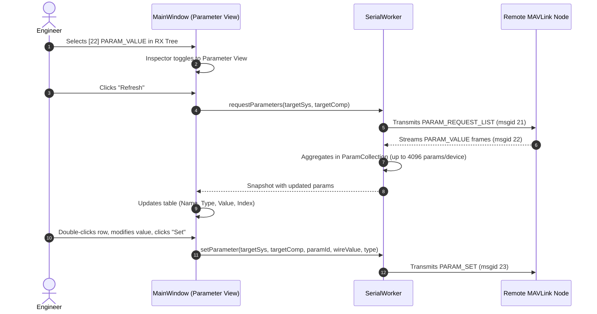
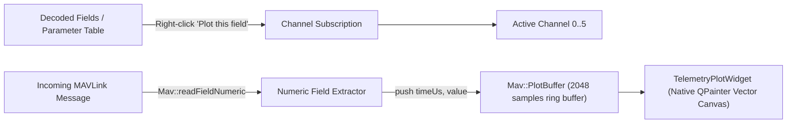

# System Architecture

**Scope:** Desktop serial workbench for Ubuntu/Linux, built with C++17 and Qt 6. This document describes the implementation in the current repository checkout.

---

## 1. Components and Dependencies

The system is partitioned into strictly bounded layers:

| Component | Source Files | Responsibilities |
| --- | --- | --- |
| **Application Entry** | [src/main.cpp](../src/main.cpp) | Instantiates `QApplication`, registers metatypes, sets window icon, launches event loop. |
| **GUI Thread** | [src/window.h](../src/window.h), [src/window.cpp](../src/window.cpp) | UART configuration bar, TX message cards, RX tree hierarchy, Decoded Fields table, Parameter Protocol view, Telemetry Plotter canvas, Settings and About dialogs, Light/Dark styling. |
| **Serial Worker Thread** | [src/worker.h](../src/worker.h), [src/worker.cpp](../src/worker.cpp) | Owns `QSerialPort` and 1 ms scheduling timers. Performs asynchronous I/O, parsing, TX rate pacing, stats aggregation, and immutable snapshot production. |
| **Protocol Core Engine** | [src/core.h](../src/core.h), [src/core.cpp](../src/core.cpp) | Official metadata reflection adapter, message encoding, stream parser, sliding-window rate tracking, link capacity estimation, telemetry sample ring buffers, and bounded write queue. **Strictly no Qt dependencies.** |
| **Enum Lookup Tables** | [src/mavlink_enums.h](../src/mavlink_enums.h), [src/mavlink_enums.cpp](../src/mavlink_enums.cpp) | Autogenerated lookup tables mapping symbolic MAVLink enum identifiers, names, and descriptions from dialect XML definitions. |
| **Profile Serialization** | [src/profile.h](../src/profile.h), [src/profile.cpp](../src/profile.cpp) | Encodes and decodes CBOR-formatted `.mavprofile` files using Qt Core with strict schema validation. |
| **Version Management** | [src/version.h](../src/version.h) | Semantic version comparison and non-blocking update checking via GitHub Releases API. |
| **MAVLink Submodule** | `third_party/mavlink` | Official C library header files (dialect: `ardupilotmega`, including `common`). |
| **Automated Tests** | [tests/](../tests/) | Core unit tests, PTY virtual serial workbench tests, control-line deassertion wrapping tests, profile tests, and offscreen UI visual regression tests. |

---

## 2. Threading and Ownership Model

```mermaid
flowchart TD
    subgraph GUI["GUI Thread (MainWindow)"]
        UI[User Interface & Controls]
        Inspector[Decoded Fields / Parameter View]
        Plotter[TelemetryPlotWidget Canvas]
        RefreshTimer[200 ms Refresh Timer]
        SettingsMgr[QSettings Persistence]
    end

    subgraph Worker["Worker Thread (SerialWorker)"]
        WorkerObj[SerialWorker QObject]
        SerialPort[QSerialPort]
        SchedTimer[1 ms Precise QTimer]
        ReconnectTimer[1000 ms Reconnect Timer]
        Queue[Mav::WriteQueue Bounded Buffer]
    end

    subgraph Core["Core Telemetry Engine (No Qt)"]
        Parser[Mav::Parser State Machine]
        Receiver[Mav::Receiver & Parameter Store]
        Scheduler[Mav::due Isochronous Pacing]
        Estimator[Throughput & Link Estimators]
        RingBuf[Mav::PlotBuffer Ring Buffers]
    end

    subgraph System["Operating System & Hardware"]
        LinuxDriver[Linux TTY Driver / Modem Control Lines]
        DeviceNode[/dev/ttyUSB*, /dev/ttyACM*, /dev/pts/*]
    end

    UI -->|Queued Invocation| WorkerObj
    RefreshTimer -->|requestSnapshot| WorkerObj
    WorkerObj -->|snapshotReady Shared Immutable Snapshot| UI
    WorkerObj -->|stateChanged / failure| UI
    Plotter -.->|Read samples| RingBuf

    WorkerObj --> SerialPort
    WorkerObj --> SchedTimer
    WorkerObj --> ReconnectTimer
    WorkerObj --> Queue
    WorkerObj --> Core

    SerialPort <--> LinuxDriver
    LinuxDriver <--> DeviceNode
```

### Thread Boundaries and Initialization
1. **Thread Affiliation:** `MainWindow` instantiates `SerialWorker` without a parent and calls `worker->moveToThread(&workerThread)`. `QThread::started` is wired to `SerialWorker::initialize()`.
2. **Resource Confinement:** `SerialWorker::initialize()` creates `QSerialPort`, the 1 ms periodic scheduler `QTimer`, and the 1000 ms auto-reconnect timer entirely inside the background thread. The GUI thread **never** touches `QSerialPort` or file descriptors directly.
3. **Communication Contracts:**
   - **GUI to Worker:** Exclusively through Qt queued method invocations (`openPort`, `closePort`, `saveEntry`, `setActive`, `sendOnce`, `runAll`, `stopAll`, `deleteAll`, `requestSnapshot`, etc.).
   - **Worker to GUI:** Asynchronous signals delivering immutable snapshots (`SnapshotPtr = std::shared_ptr<const Snapshot>`) and status notifications (`stateChanged`, `failure`).
   - **Single Outstanding Request:** The GUI maintains at most one outstanding snapshot request at a time via a 200 ms polling timer, preventing refresh request pile-ups under system load.
4. **Clean Shutdown:**
   - On `MainWindow::closeEvent()`, the refresh timer is stopped immediately.
   - `worker->closePort()` is invoked synchronously via `QMetaObject::invokeMethod(..., Qt::BlockingQueuedConnection)` to halt transmissions and purge serial buffers before window destruction.
   - `workerThread.quit()` and `workerThread.wait()` ensure the background event loop terminates cleanly before deleting the worker.

---

## 3. Runtime Flow

### 3.1. Connection Lifecycle and Linux Modem Control Lines

```text
User clicks Connect
  ↓
GUI validates device path and baud rate (1 to 12,000,000)
  ↓
Worker::openPort() closes any prior session
  ↓
SerialPort->open(ReadWrite)
  ↓
Linux Modem Control Policy (TIOCMBIC / TIOCMGET)
  - Deasserts DTR and RTS simultaneously if enabled
  - Hardware flow control preserves driver ownership of RTS
  - Verified driver bit readback ensures line deassertion
  ↓
Purge OS and Qt Buffers (tcflush, port->clear, port->readAll)
  ↓
Worker emits stateChanged("Connected", true)
[No automatic frames or HEARTBEATs transmitted]
```

- **Device Enumeration:** The port dropdown filters and presents active hardware devices (USB converters, CDC-ACM devices, onboard UARTs) while preserving custom virtual PTY paths entered during testing.
- **Auto-Reconnect Strategy:** If an open link is unexpectedly dropped (e.g. `ResourceError`, physical cable disconnect), the worker halts all active transmissions, discards pending queues, transitions to `Reconnecting`, and attempts reconnection at 1000 ms intervals. Manual `closePort()` cancels auto-reconnect immediately.
- **Deassert DTR/RTS on Connect:** Configurable via **Settings → Serial Management** (enabled by default). Mitigates unwanted hardware auto-reset on connected boards (e.g. Arduino DTR reset or flight controller bootloader triggers).

### 3.2. Transmission Pipeline (TX)

```text
Editor Dialog commits message
  ↓
Mav::validTx() validates payload size, message ID, and frequency
  ↓
Worker::saveEntry() stores entry in stopped state (active = false)
  ↓
User starts entry (or clicks Run all)
  ↓
Worker::setActive(key, true) sets immediate deadline
  ↓
1 ms scheduler tick checks Mav::due(entry, now)
  ↓
Isochronous progression: entry.deadline += interval
  ↓
Mav::encode() serializes wire frame via official MAVLink finalizer
  ↓
Mav::WriteQueue::push() buffers frame (16,384 bytes limit)
  ↓
Worker::pump() flushes up to 4,096 bytes per iteration to QSerialPort
  ↓
Frame count and measured rate update upon full hand-off to Qt output
```

- **Pacing & Anti-Drift Scheduling:** The scheduler evaluates deadlines against monotonic microsecond clocks (`QElapsedTimer`). When a deadline arrives, `due()` advances the deadline isochronously (`deadline += interval`) to eliminate cumulative phase drift caused by operating system jitter. A generous jitter tolerance threshold (`max(20ms, 2 * interval)`) prevents catch-up bursts after system sleep while preserving deterministic pacing up to 1000 Hz.
- **Permissive Rate Transmission:** Transmission frequency is not rejected by pre-flight capacity gating; offered loads exceeding link capacity are scheduled normally, and real-time link saturation is transparently reported on the card's **Actual Rate** indicator and link load badges.
- **Bounded Write Queue:** An internal `WriteQueue` buffers up to 16,384 bytes. If the queue overflows or write errors occur, the affected stream transitions to `Stopped` and emits a descriptive failure reason.

### 3.3. Reception Pipeline (RX)

```text
QSerialPort::readyRead signal
  ↓
Worker reads chunks up to 8,192 bytes
  ↓
Mav::Parser::feed() processes bytes through official parser state machine
  ↓
Valid frames emitted; crcErrors / signatureErrors incremented on errors
  ↓
Mav::Receiver::accept() updates stream map:
  - Key: tuple<sysid, compid, msgid> (max 2048 streams)
  - Updates latest message, frame count, arrival timestamp, and sliding rate
  ↓
Special Handling: [22] PARAM_VALUE messages collected into ParamCollection
  ↓
Snapshot emitted to GUI at 5 Hz
  ↓
RX grouped tree updates in place (System · Component → Leaf Message)
  ↓
Inspector displays Decoded Fields or Parameter View
```

- **Smart Grouped Tree Architecture:** RX streams are presented in a clean two-level hierarchy: Level 1 is the Device group banner (`System X · Component Y`), and Level 2 contains the leaf message streams with inline freshness status dots (Green for Active $\le 1.2$ s, Amber for Stale $\le 3.0$ s, Muted for Inactive $> 3.0$ s).
- **Pause Display:** Freezes the visual presentation while parser, counters, and statistics continue running in the background.

---

## 4. Parameter Protocol & Dual-Mode Inspector

MAVLink Parameter Protocol transmits all parameters under a single stream identity: `[22] PARAM_VALUE`.



- **Type-Punning:** MAVLink packs parameter values into a 32-bit `float param_value`. Integer parameters (`UINT8`, `INT8`, `UINT16`, `INT16`, `UINT32`, `INT32`) strictly use standard union type-punning (`mavlink_param_union_t`) to avoid precision loss or IEEE-754 NaN corruption.
- **Dual-Mode Inspector:** Selecting `[22] PARAM_VALUE` switches the inspector pane to **Parameter View**; selecting any other message immediately restores the standard **Decoded Fields View**.

---

## 5. Real-Time Telemetry Plotter

The telemetry plotter displays rolling waveforms of numeric fields extracted from live MAVLink messages:



- **Zero Heap Allocations:** Each subscribed channel uses a preallocated `Mav::PlotBuffer` with a fixed capacity of 2048 samples. New samples overwrite the oldest in a circular ring buffer without runtime heap allocations.
- **Safe Numeric Extraction:** `Mav::readFieldNumeric` extracts all integer (`uint8`..`uint64`, `int8`..`int64`) and floating-point (`float`, `double`) fields while rejecting strings and non-finite values (`NaN`, `Inf`).
- **Native Vector Canvas:** `TelemetryPlotWidget` uses antialiased `QPainter` vectors to render waveforms, grid lines, Y-axis labels, hairline inspection cursor, and channel legends directly on a native Qt widget, eliminating external dependencies like QCustomPlot or QtCharts.

---

## 6. Throughput Tracking & Link Load Estimation

- **Sliding Window Rate Tracking:** `Mav::ByteRate` maintains a 1.0-second sliding window ring buffer of received and transmitted bytes, providing jitter-free throughput measurements.
- **Physical UART Framing Calculation:**
  $$\text{bitsPerByte} = 1\text{ (Start)} + N_{\text{data}} + N_{\text{parity}} + N_{\text{stop}}$$
  $$\text{Utilization (\%)} = \frac{\text{Bytes/sec} \times \text{bitsPerByte}}{\text{Baudrate}} \times 100$$
- **Pre-Flight Estimation:** The TX Dashboard header displays a real-time third pill (`~X B/s (Y%)`) indicating planned channel utilization with theme-aware warning colors (Blue $\le 70\%$, Amber $> 70\%$, Red $> 90\%$).

---

## 7. State Persistence & Decoupled Scopes

Application state is persisted across sessions in `~/.config/MAVLinkSimulator/` under isolated `QSettings` scopes:

| Scope | Contents | Defaults |
| --- | --- | --- |
| `MAVLinkSimulator/Preferences` | UI theme, default System/Component IDs, default wire version, auto-reconnect, deassert control lines, debug status bar visibility, and rate display units. | Theme: System, SysID: 1, CompID: 1, Version: 2, Deassert: true. |
| `MAVLinkSimulator/Layout` | Window dimensions (1440×900), dashboard splitter sizes (`{467, 929}` px), inspector splitter sizes, and column widths. | Reset Layout button restores defaults. |
| `MAVLinkSimulator/Workspace` | Saved TX message definitions (IDs, sender IDs, target rates, payload bytes). | **Restoration is OFF by default (`false`)** for safety. Restored entries start strictly in `Stopped` state. |

- **Signal Blocking:** Restoring settings utilizes `QSignalBlocker` to prevent widget event signals from prematurely triggering `saveSettings()`. Every write is immediately finalized with `settings.sync()`.

---

## 8. Resource Constraints and Buffer Limits

| Boundary / Metric | Limit | Behavior on Limit |
| --- | --- | --- |
| **Configured TX Entries** | 128 messages | Additional additions rejected. |
| **RX Identities** | 2048 streams | Additional unique `(sysid, compid, msgid)` tuples increment `overflow`. |
| **Parameters per Device** | 4096 parameters | Excess parameters rejected to prevent memory exhaustion. |
| **Application TX Queue** | 16,384 bytes | Overflow stops the active entry and reports error. |
| **Qt Pending Output** | 4,096 bytes | `pump()` pauses writing until previous bytes are flushed. |
| **Qt Read Buffer** | 65,536 bytes | Internal buffer allocated by `QSerialPort`. |
| **Plotter Ring Buffer** | 2048 samples/channel | Overwrites oldest sample (circular ring buffer). |
| **Profile File Size** | 1,048,576 bytes (1 MiB) | Profiles exceeding 1 MiB are rejected. |
| **Scheduler Resolution** | 1 millisecond | Best-effort timer resolution under Linux. |

---

## 9. Security and Hardware Invariants

- **No Inferred Capabilities:** Asynchronous I/O or PTY testing does not imply DMA support or physical UART transceiver capabilities.
- **Unauthenticated Signatures:** MAVLink frames containing signatures are parsed but not authenticated; the system does not configure signing keys.
- **No Automatic Physical Transmissions:** Connecting or reconnecting to a serial device will never send frames or heartbeats without explicit user action.
