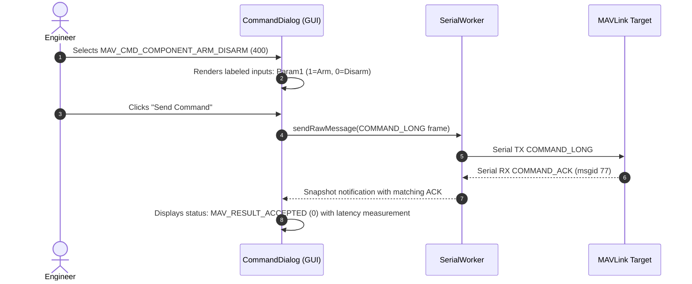
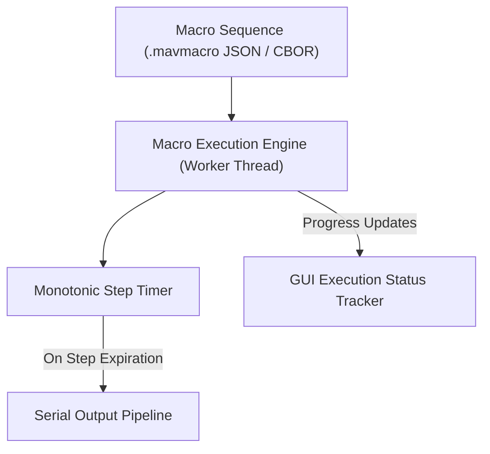

# Advanced Feature Proposals for MAVLinkLab

This document details the architectural design and implementation proposals for the advanced feature roadmap of **MAVLinkLab**, including:

1. **Proposal 2: Telemetry Real-Time Plotter** — **[COMPLETED / IMPLEMENTED]**
2. **Proposal 3: Command Protocol Helper & Interactive ACK Listener** (`MAV_CMD` Wizard) — *[Planned]*
3. **Proposal 6: TX Automation: Sequences & Macros** — *[Planned]*
4. **Extension to Proposal 6: Event-Driven TX Trigger / Auto-Responder** — *[Planned]*

---

## 1. Proposal 2: Telemetry Real-Time Plotter [COMPLETED]

### Status: Fully Implemented in `src/core.*` and `src/window.*`

### 1.1. Context & Motivation
During flight controller and embedded node development over serial MAVLink:
- The standard *Decoded Fields* table displays instantaneous numeric values at the GUI refresh interval (5 Hz).
- Engineers require continuous waveform visualization to analyze dynamic physical behaviors: roll/pitch response (`ATTITUDE.roll`, `pitch`), altitude (`VFR_HUD.alt`), IMU vibration spectra (`SCALED_IMU.xacc`), or battery voltage sag (`BATTERY_STATUS.voltages`).
- **Goal:** Provide a lightweight, zero-dependency rolling waveform strip-chart canvas that allows instant pinning of numeric telemetry fields.

### 1.2. Implemented Architecture
- **Zero-Allocation Ring Buffer (`Mav::PlotBuffer`):** Fixed 2048 sample ring buffer per channel, preallocated once. Samples overwrite oldest entries without runtime heap churn.
- **Safe Numeric Extraction (`Mav::readFieldNumeric`):** Extracts any integer (`uint8`..`uint64`, `int8`..`int64`) or floating-point (`float`, `double`) value as `double`, automatically rejecting strings and non-finite numbers (`NaN`, `Inf`).
- **Lightweight Native `QPainter` Canvas (`TelemetryPlotWidget`):** Implements antialiased vector plotting directly on a native Qt widget, integrating seamlessly with Light and Dark design tokens with no external graphic libraries.
- **Interactive Controls:** Supports up to 6 simultaneous channels, sliding time windows (10s, 30s, 60s, 120s), dynamic Y-axis auto-scaling, pause/freeze inspection cursor, and offline CSV data export.

---

## 2. Proposal 3: Command Protocol Helper & Interactive ACK Listener (`MAV_CMD` Wizard)

### Status: Planned

### 2.1. Context & Motivation
- `COMMAND_LONG` (msgid 76) and `COMMAND_INT` (msgid 75) are standard methods for issuing commands to flight vehicles and gimbals (Arm/Disarm, Flight Mode switch, Sensor Calibration, Reboot, Video Record).
- **Current Challenge:** Engineers must look up command numeric IDs manually, populate 7 raw float parameters (`param1`..`param7`) that have completely different meanings per command, and then manually search through hundreds of received messages to locate the corresponding `COMMAND_ACK` (msgid 77).
- **Goal:** Provide a dedicated dialog wizard with command search, schema-driven parameter labels, auto-completion, and real-time `COMMAND_ACK` tracking.

### 2.2. Technical Architecture



### 2.3. Implementation Specification
1. **Command Catalog & Metadata:**
   - Extract `MAV_CMD` enum definitions, parameter descriptions, and enum options from dialect XML definitions into lookup tables (extending `tools/generate_mavlink_enums.py`).
2. **Interactive Command Dialog:**
   - Command selector with search autocompletion (by name or numeric ID).
   - Target System ID and Component ID fields (defaulting to active target).
   - Dynamic parameter rows: Displays semantic parameter descriptions (e.g. `param1: 1.0 (Arm)`, `param2: 21196 (Force Arming)`).
3. **ACK Listener & Timeout Tracker:**
   - Tracks transmitted command transaction: `(targetSys, targetComp, commandId, timestamp)`.
   - Listens for matching `COMMAND_ACK` in background snapshots.
   - Reports execution result (`ACCEPTED`, `TEMPORARILY_REJECTED`, `DENIED`, `UNSUPPORTED`, `FAILED`, `IN_PROGRESS`) and round-trip latency in milliseconds.
   - Configurable timeout (default: 3000 ms) with retry options.

---

## 3. Proposal 6: TX Automation: Sequences & Macros

### Status: Planned

### 3.1. Context & Motivation
- Verification workflows often require ordered sequences of MAVLink messages with specific timing delays rather than continuous periodic streaming.
- Examples:
  - **Vehicle Arming Sequence:** Send `HEARTBEAT` $\rightarrow$ wait 500 ms $\rightarrow$ send `PARAM_REQUEST_LIST` $\rightarrow$ wait 1000 ms $\rightarrow$ send `MAV_CMD_COMPONENT_ARM_DISARM`.
  - **Camera Trigger Loop:** Send `COMMAND_LONG(MAV_CMD_DO_DIGICAM_CONTROL)` every 2 seconds for 10 iterations.
- **Goal:** Allow engineers to script and execute timed message sequences with step delays, repeat counts, and verification checkpoints.

### 3.2. Architecture & Data Model



### 3.3. Key Capabilities
- **Step Primitives:**
  - `SEND(msg_id, payload)`: Transmit a specific message once.
  - `WAIT(ms)`: Pause execution for specified duration.
  - `WAIT_ACK(cmd_id, timeout_ms)`: Wait until matching `COMMAND_ACK` is received.
  - `REPEAT(n)`: Loop sub-sequences.
- **Execution Engine:** Hosted in the worker thread to guarantee microsecond timing precision independent of GUI event loop delays.
- **Visual Progress Display:** Step-by-step progress bar showing active step, elapsed time, and iteration counters.

---

## 4. Extension: Event-Driven TX Trigger / Auto-Responder

### Status: Planned

### 4.1. Context & Motivation
- In standalone workbench testing, flight controllers or companion computers often request data from external sensors or gimbals:
  - Requesting camera information: Remote node sends `COMMAND_LONG(MAV_CMD_REQUEST_MESSAGE, param1=259)` $\rightarrow$ expected response: `CAMERA_INFORMATION` (msgid 259).
  - Ping / Round-trip latency: Remote node sends `PING` (msgid 4) $\rightarrow$ expected response: echo `PING` with identical sequence.
- **Goal:** Configure rule-based automated responses that trigger immediate transmission upon receiving specific messages or field conditions.

### 4.2. Rule Architecture
```json
{
  "trigger": {
    "msgid": 76,
    "conditions": [
      { "field": "command", "operator": "==", "value": 512 }
    ]
  },
  "action": {
    "send_msgid": 259,
    "delay_ms": 20,
    "payload_template": "camera_info_profile"
  }
}
```

- Handled strictly within the worker thread for rapid response times ($< 5$ ms).
- Integrated with link load estimator to prevent trigger cascades.
