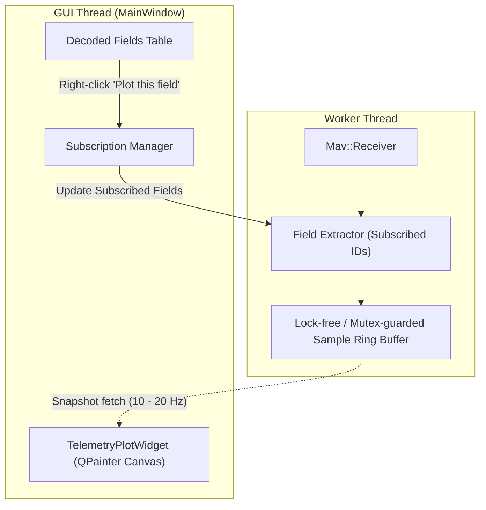
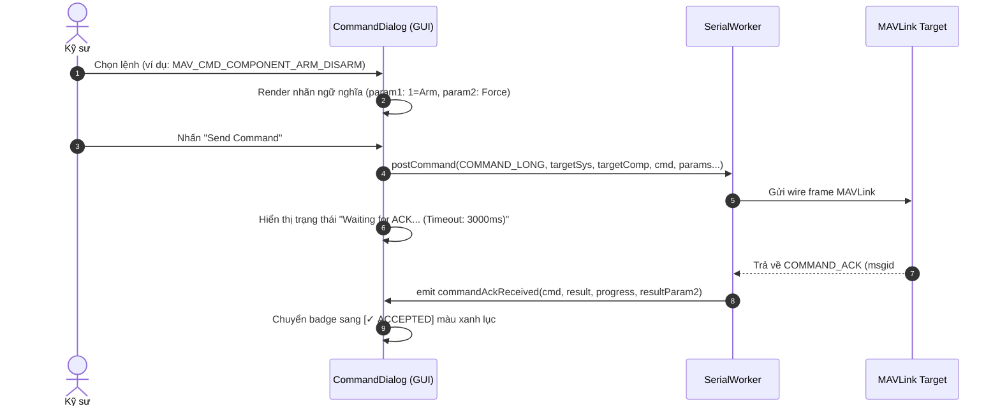

# Đề xuất chi tiết: Các tính năng nâng cao cho MAVLinkLab

Tài liệu này trình bày thiết kế kiến trúc chi tiết cho các đề xuất phát triển tiếp theo của **MAVLinkLab**, bao gồm:
1. **Đề xuất 2: Telemetry Real-time Plotter** (Đồ thị viễn trắc thời gian thực)
2. **Đề xuất 3: Command Protocol Helper & Interactive ACK Listener** (`MAV_CMD` Wizard)
3. **Đề xuất 6: TX Automation: Sequences & Macros** (Kịch bản chuỗi truyền phát)
4. **Mở rộng đề xuất 6: Event-driven TX Trigger / Auto-responder** (Bộ phản hồi tự động theo sự kiện RX)

---

## 1. Đề xuất 2: Telemetry Real-time Plotter (Đồ thị viễn trắc thời gian thực)

### 1.1. Bối cảnh & Mục tiêu
Trong quá trình debug hệ thống điều khiển bay và thiết bị nhúng qua MAVLink:
- Bảng *Decoded Fields* hiện tại chỉ thể hiện giá trị số tức thời tại chu kỳ làm tươi giao diện (5 Hz).
- Kỹ sư gặp khó khăn lớn khi đánh giá các tín hiệu biến thiên liên tục: đáp ứng góc nghiêng (`ATTITUDE.roll`, `pitch`), độ cao (`VFR_HUD.alt`), dao động rung cảm biến (`SCALED_IMU.xacc`), hoặc sụt áp pin (`BATTERY_STATUS.voltages`).
- **Mục tiêu:** Cung cấp đồ thị dạng sóng thời gian thực (real-time rolling waveform) siêu nhẹ, zero-dependency, cho phép ghim nhanh các trường số để theo dõi trực quan.

### 1.2. Kiến trúc & Thiết kế kỹ thuật



#### A. Cấu trúc dữ liệu Ring Buffer (Không cấp phát động liên tục)
Để tránh cấp phát bộ nhớ động (`malloc`/`new`) trên mỗi frame nhận được, dữ liệu đồ thị được quản lý bằng bộ đệm vòng kích thước cố định:

```cpp
namespace Mav
{

struct PlotSample
{
    uint64_t timestampUs; // Monotonic microseconds
    double value;
};

class PlotChannelBuffer
{
public:
    static constexpr size_t Capacity = 2048; // ~34s ở tần số 60Hz

    void push(uint64_t timestampUs, double value);
    std::vector<PlotSample> readSnapshot() const;
    void clear();

private:
    std::array<PlotSample, Capacity> buffer_{};
    size_t head_{0};
    size_t count_{0};
};

} // namespace Mav
```

#### B. Engine hiển thị: Lightweight Native `QPainter` Widget
* **Quyết định kiến trúc:** Thay vì kéo các thư viện đồ họa nặng nề (`QCustomPlot`, `QtCharts`), xây dựng `TelemetryPlotWidget` kế thừa `QWidget`, sử dụng `QPainter` kết hợp `QPolygonF` với antialiasing.
* **Lý do:**
  - Zero external dependency, tương thích 100% với hệ thống build CMake và pipeline CI offscreen hiện tại.
  - Tải CPU cực thấp (<2% CPU cho 4 kênh ở 20 FPS).
  - Tích hợp liền mạch với hệ thống design token và màu theme (Light `#edf1f8` / Dark `#1b2333`).

#### C. Giao diện & Luồng tương tác người dùng (UI/UX)
1. **Ghim kênh (Pin to Plot):** Click chuột phải vào bất kỳ hàng nào trong bảng *Decoded Fields* $\rightarrow$ context menu hiển thị tùy chọn **"Plot this field"**.
2. **Khung hiển thị:** Mở dock panel bên dưới hoặc tab liền kề với bảng *Decoded Fields*.
3. **Các tính năng điều khiển:**
   - Hỗ trợ tối đa **4 – 6 kênh đồng thời**, mỗi kênh sở hữu một màu sắc tương phản cao (Cyan, Amber, Violet, Emerald, Rose).
   - **Time Range Selector:** Chọn cửa sổ trượt hiển thị: 10s, 30s, 60s, 120s.
   - **Auto-Scale Y Axis:** Tự động co giãn trục tung theo giá trị min/max hiện thời, có nút khóa dải đo (Manual range lock).
   - **Pause / Freeze:** Dừng cuộn đồ thị để rê chuột soi giá trị (inspection cursor với tooltip hiển thị thời gian và giá trị chính xác).
   - **Export:** Xuất ảnh chụp đồ thị (PNG) hoặc dữ liệu dạng bảng (CSV).

---

## 2. Đề xuất 3: Command Protocol Helper & Interactive ACK Listener (`MAV_CMD` Wizard)

### 2.1. Bối cảnh & Mục tiêu
- `COMMAND_LONG` (msgid #76) và `COMMAND_INT` (msgid #75) là phương thức tiêu chuẩn để ra lệnh cho máy bay (Arm/Disarm, Set Mode, Calibrate Gyro/Accel, Reboot FC, Start Video Record).
- **Khó khăn hiện tại:** Kỹ sư phải tra cứu ID lệnh thủ công, tự nhập 7 tham số số thực (`param1`..`param7`) vốn mang ý nghĩa khác nhau cho từng lệnh, sau đó phải tự tìm message `COMMAND_ACK` (msgid #77) trong danh sách hàng trăm RX message để xem lệnh có thành công hay không.
- **Mục tiêu:** Cung cấp hộp thoại chuyên dụng để cấu hình và phát lệnh trực quan, tự động gán nhãn cho các tham số theo schema, và theo dõi phản hồi `COMMAND_ACK` theo thời gian thực.

### 2.2. Kiến trúc & Thiết kế kỹ thuật



#### A. Command Metadata Schema & Reflection
Mở rộng bộ metadata reflection trong `src/core.*` để ánh xạ thông tin các lệnh phổ biến:

```cpp
struct CommandParamMeta
{
    QString label;        // Tên tham số ngữ nghĩa (e.g. "Arm / Disarm")
    QString description;  // Tooltip giải thích chi tiết
    double defaultValue;  // Giá trị mặc định
    double minVal;
    double maxVal;
    enum class InputType { Decimal, Integer, EnumDropdown, BooleanToggle } type;
    std::vector<std::pair<int, QString>> enumOptions; // Danh sách lựa chọn nếu là dropdown
};

struct CommandDefinition
{
    uint16_t commandId;
    QString name;         // e.g. "MAV_CMD_COMPONENT_ARM_DISARM"
    QString description;
    std::array<CommandParamMeta, 7> params;
};
```

#### B. ACK Correlation & Timeout State Machine
1. Khi phát lệnh, `MainWindow` ghi nhận bản ghi chờ phản hồi (`PendingCommand`):
   - Lưu trữ: `commandId`, `targetSystem`, `targetComponent`, `timestampUs`.
   - Khởi chạy một `QTimer` one-shot (3000 ms) phòng trường hợp timeout.
2. Khi `SerialWorker` giải mã được `COMMAND_ACK` (msgid #77):
   - Khớp `command` và `target_system` với lệnh vừa gửi.
   - Trích xuất trường `result` theo chuẩn MAVLink (`MAV_RESULT`):
     - `MAV_RESULT_ACCEPTED` (0): Thành công $\rightarrow$ Hiển thị badge xanh lục rực rỡ (`ACCEPTED`).
     - `MAV_RESULT_TEMPORARILY_REJECTED` (1): Từ chối tạm thời $\rightarrow$ Badge màu hổ phách.
     - `MAV_RESULT_DENIED` (2) / `FAILED` (4): Lỗi $\rightarrow$ Badge màu đỏ kèm mã lỗi.
     - `MAV_RESULT_IN_PROGRESS` (5): Đang thực thi $\rightarrow$ Hiển thị thanh tiến độ theo trường `progress` (0–100%).
3. **Quick Command Presets:** Tích hợp thanh nút bấm thao tác nhanh một chạm cho các lệnh tần suất cao:
   - **Arm / Disarm** (hỗ trợ Force Arm)
   - **Preflight Reboot / Shutdown** (Reboot Autopilot hoặc Companion Computer)
   - **Calibrate Accelerometer / Gyro / Compass**
   - **Request Message Stream** (Yêu cầu truyền một msgid cụ thể ở tần số mong muốn)

---

## 3. Đề xuất 6: TX Automation: Sequences & Macros (Kịch bản chuỗi truyền phát)

### 3.1. Bối cảnh & Mục tiêu
- Nhiều kịch bản kiểm thử thiết bị nhúng yêu cầu thực hiện tuần tự một chuỗi các bước có độ trễ xác định.
  *Ví dụ:* Gửi yêu cầu nạp tham số $\rightarrow$ Chờ 500 ms $\rightarrow$ Gửi lệnh chuyển chế độ bay `GUIDED` $\rightarrow$ Chờ 1000 ms $\rightarrow$ Gửi lệnh cất cánh `TAKEOFF` $\rightarrow$ Bắt đầu truyền dữ liệu tọa độ mục tiêu.
- **Mục tiêu:** Xây dựng cơ chế chạy kịch bản (Sequence Runner) hoàn toàn phi chặn (non-blocking) trên worker thread, cho phép lưu và nạp kịch bản vào file cấu hình Profile.

### 3.2. Cấu trúc dữ liệu & Thiết kế thực thi

```cpp
namespace Mav
{

enum class StepType
{
    SendMessage,       // Gửi một tin nhắn được định nghĩa trước
    Delay,             // Dừng chờ N milliseconds
    WaitForAck,        // Chờ nhận COMMAND_ACK cho một command cụ thể
    WaitForMessage     // Chờ nhận một msgid cụ thể (e.g. PARAM_VALUE)
};

struct SequenceStep
{
    StepType type{StepType::SendMessage};
    TxEntry messageEntry;     // Payload và cấu hình nếu type == SendMessage
    uint32_t durationMs{0};   // Thời gian delay hoặc timeout (ms)
    uint32_t expectedMsgId{0};// ID message mong đợi nếu type == WaitForMessage
};

struct TxSequence
{
    QString name;
    QString description;
    bool loop{false};
    std::vector<SequenceStep> steps;
};

} // namespace Mav
```

### 3.3. Cơ chế lập lịch trên Worker Thread
- Thực thi kịch bản bằng máy trạng thái (state machine) tích hợp trong vòng lặp `SerialWorker::tick()` với đồng hồ đơn điệu `std::chrono::steady_clock`.
- Không sử dụng các lệnh block như `sleep()` hay vòng lặp bận (busy-wait).
- Phát tín hiệu tiến trình ra GUI thread: `emit sequenceProgress(sequenceName, currentStepIndex, totalSteps, stepStatus)`.
- Các nút điều khiển trên giao diện: **Play (Chạy)**, **Pause (Tạm dừng)**, **Resume (Tiếp tục)**, **Abort (Hủy)**.
- Tích hợp vào định dạng file Profile JSON (`.json`) theo cấu trúc mở rộng:
  ```json
  {
    "version": 1,
    "messages": [ ... ],
    "sequences": [
      {
        "name": "Pre-flight Calibration Workflow",
        "loop": false,
        "steps": [
          { "type": "send", "msgid": 76, "name": "COMMAND_LONG (Calib Gyro)" },
          { "type": "wait_ack", "command": 241, "timeout_ms": 5000 },
          { "type": "delay", "delay_ms": 1000 },
          { "type": "send", "msgid": 76, "name": "COMMAND_LONG (Arm)" }
        ]
      }
    ]
  }
  ```

---

## 4. Mở rộng đề xuất 6: Event-driven TX Trigger / Auto-responder (Kích hoạt phản hồi tự động theo sự kiện RX)

### 4.1. Bối cảnh & Mục tiêu (Ý tưởng người dùng)
- **Bài toán đặt ra:** *Thiết lập gửi một lần (Send Once) một message đã lưu trước đó ngay khi nhận được một message cụ thể.*
  *Ví dụ tiêu biểu:*
  - Nhận `COMMAND_LONG` $\rightarrow$ Tự động gửi phản hồi `COMMAND_ACK`.
  - Nhận `PING` (msgid #4) $\rightarrow$ Tự động gửi trả `PING` tương ứng.
  - Nhận `PARAM_REQUEST_READ` $\rightarrow$ Tự động gửi `PARAM_VALUE`.
  - Nhận `MISSION_REQUEST` $\rightarrow$ Tự động phát `MISSION_ITEM`.
- **Ứng dụng thực tế:**
  1. **Autopilot / Subsystem Mocking:** Cho phép MAVLinkLab giả lập hoàn hảo một Flight Controller hoặc tải trọng (Payload/Gimbal/Camera) để kiểm thử Ground Control Station (GCS) hoặc Companion Computer mà không cần phần cứng thật.
  2. **Automated Handshake Testing:** Tự động phản hồi để duy trì liên kết mà không đòi hỏi kỹ sư phải nhấn nút bằng tay.

### 4.2. Kiến trúc & Thiết kế kỹ thuật

```mermaid
flowchart LR
    WireData["Dữ liệu Serial RX"] --> Parser["Mav::Receiver::feed()"]
    Parser --> ValidFrame["Packet RX hợp lệ"]
    
    subgraph TriggerEngine["Trigger Engine (Worker Thread)"]
        ValidFrame --> Matcher{"Khớp điều kiện?<br/>(MsgID, SysID, Field)"}
        Matcher -->|Yes| ApplyMapping["Sao chép trường động<br/>(Field Mapping)"]
        ApplyMapping --> DelayCheck{"Delay > 0?"}
        DelayCheck -->|No (0ms)| OutQueue["Đưa ngay vào WriteQueue"]
        DelayCheck -->|Yes| DelayedQueue["Lập lịch Monotonic Timer"]
        DelayedQueue --> OutQueue
    end
    
    OutQueue --> TX["Gửi ra Serial UART"]
    ValidFrame -.->|"Cập nhật thống kê"| GUI["GUI Thread (Dashboard)"]
```

#### A. Cấu trúc dữ liệu Rule Trigger (`Mav::TriggerRule`)

```cpp
namespace Mav
{

struct FieldMatchCondition
{
    QString fieldName;       // Tên trường cần so sánh (e.g. "command")
    double expectedValue;    // Giá trị mong muốn (e.g. 400 cho MAV_CMD_COMPONENT_ARM_DISARM)
};

struct DynamicFieldMapping
{
    QString sourceField;     // Trường trên tin nhắn RX (e.g. "command")
    QString targetField;     // Trường ghi vào tin nhắn TX phản hồi (e.g. "command")
};

struct TriggerRule
{
    uint32_t ruleId{0};
    QString name;            // Tên định danh (e.g. "Auto ACK on COMMAND_LONG")
    bool enabled{true};
    bool oneShot{false};     // Nếu true: tự động vô hiệu hóa sau 1 lần kích hoạt

    // --- Điều kiện kích hoạt (Trigger Condition) ---
    uint32_t triggerMsgId{0};// ID message kích hoạt (e.g. 76 cho COMMAND_LONG)
    int triggerSysId{-1};    // -1: chấp nhận mọi System ID
    int triggerCompId{-1};   // -1: chấp nhận mọi Component ID
    std::vector<FieldMatchCondition> conditions; // Điều kiện lọc giá trị trường (tùy chọn)

    // --- Hành động phản hồi (Response Action) ---
    TxEntry responseMessage; // Template tin nhắn sẽ gửi
    uint32_t delayMs{0};     // Độ trễ phản hồi (mô phỏng thời gian xử lý thực tế của vi điều khiển)
    std::vector<DynamicFieldMapping> mappings; // Sao chép giá trị từ RX sang TX

    // Thống kê
    uint64_t triggerCount{0};
    uint64_t lastTriggerTimeUs{0};
};

} // namespace Mav
```

#### B. Cơ chế thực thi độ trễ thấp (Sub-millisecond Latency)
* **Thực thi hoàn toàn trên Worker Thread:** Toàn bộ quá trình kiểm tra khớp mẫu (pattern matching) và phát tin nhắn phản hồi được xử lý ngay tại thời điểm `Mav::Receiver` hoàn tất giải mã một frame hợp lệ.
* **Lợi ích kiến trúc:**
  - Độ trễ phản xạ chỉ dưới **1 miligiây (sub-millisecond)**, mô phỏng chính xác phản ứng của firmware nhúng.
  - Hoàn toàn không phụ thuộc vào chu kỳ làm tươi màn hình của GUI (200 ms).
  - Tự động sao chép các trường động quan trọng: Ví dụ khi nhận `COMMAND_LONG`, hệ thống tự động copy `sysid` của bên gửi làm `target_system` cho `COMMAND_ACK`, và copy mã lệnh `command` sang trường `command` của ACK.

#### C. Giao diện quản lý Trigger Rules trên UI
1. Bổ sung một bảng phụ hoặc tab chuyên dụng **"Auto Responders / Triggers"** trong không gian TX Dashboard.
2. Danh sách các quy tắc hiển thị rõ: Tên quy tắc, Tin nhắn kích hoạt (`RX [ID]`), Tin nhắn phản hồi (`TX [ID]`), Trạng thái On/Off, Số lần đã kích hoạt (`Fired: X`).
3. Cung cấp các **Quick Preset Templates** sẵn có để kích hoạt ngay:
   - **Auto ACK All Commands:** Luôn trả lời `COMMAND_ACK` (kết quả `ACCEPTED`) cho mọi `COMMAND_LONG` / `COMMAND_INT` nhận được.
   - **Auto Reply Ping:** Trả lời gói tin `PING` giữ nguyên số thứ tự sequence.
   - **Heartbeat Mirroring:** Tự động kích hoạt luồng truyền khi phát hiện Heartbeat từ thiết bị lạ.

---

## 5. Bảng so sánh & Đánh giá mức độ ưu tiên triển khai

| Tính năng | Độ phức tạp | Tác động kiến trúc | Giá trị thực tiễn | Thứ tự khuyến nghị |
| :--- | :---: | :---: | :---: | :---: |
| **Đề xuất 3: Command Protocol Helper** | Trung bình | Thấp (GUI Dialog + Core metadata) | Rất cao (Thao tác hàng ngày) | **Ưu tiên 1** |
| **Mở rộng 6: Event-driven TX Trigger** | Trung bình | Trung bình (Bổ sung matcher trong Worker) | Cực cao (Giả lập drone/thiết bị) | **Ưu tiên 2** |
| **Đề xuất 2: Telemetry Real-time Plotter** | Trung bình - Cao | Trung bình (Ring buffer + Custom painter) | Cao (Phân tích động học & nhiễu) | **Ưu tiên 3** |
| **Đề xuất 6: TX Sequences / Macros** | Trung bình | Trung bình (State machine trong Worker) | Khá (Tự động hóa kịch bản phức tạp)| **Ưu tiên 4** |

---

## 6. Tổng kết
Tất cả 4 tính năng chi tiết trên đều tuân thủ chặt chẽ các nguyên tắc cốt lõi của **MAVLinkLab**:
1. Độc lập tuyệt đối giữa logic giao thức (`core`) và giao diện (`window`).
2. Mọi tác vụ I/O, tính toán thời gian và phản xạ tự động đều nằm tại `worker` thread với đồng hồ đơn điệu (`monotonic clock`).
3. Giữ giao diện người dùng mượt mà, trực quan theo phong cách tối giản hiện đại (Swiss Minimalist Dashboard).

